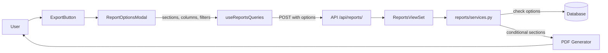

# Phase 9b — Report Customization

### Overview
Enhance **Phase 9 — Export & Reporting** with full customization: users select which sections, columns, filters, and charts to include in their PDF/CSV exports.

### Scope

**In Scope:**
- **Section Selection** — Checkboxes to include/exclude: Summary, Category Breakdown, Transaction Details, Charts/Projections
- **Column Selection** — Choose which columns appear in transaction tables (Date, Type, Amount, Account, Category, Income Source, Project Item, Description)
- **Filter Controls** — Apply date range, transaction type, account, and category filters before export
- **Chart Options** — Toggle chart inclusion in PDF reports
- **Settings Persistence** — Remember last used export settings per report type in localStorage

**Out of Scope:**
- Custom report templates
- Scheduled exports
- Multi-currency reports

### User Stories
1. As a user, I want to choose which sections appear in my PDF so I can create focused reports.
2. As a user, I want to select which columns appear in transaction tables so I control the detail level.
3. As a user, I want to apply filters before exporting so I get only relevant data.
4. As a user, I want to include or exclude charts so I can choose between visual or text-only reports.
5. As a user, I want my export preferences remembered so I don't reconfigure every time.

### Functional Requirements
- **Section Checkboxes**: Summary, Category Breakdown, Transaction Details, Charts/Projections
- **Column Selectors**: Date, Type, Amount, Account, Category, Income Source, Project Item, Description
- **Filter Controls**: Date range picker, transaction type dropdown, account/category selectors
- **Chart Toggles**: Include/exclude specific chart types
- **Settings Persistence**: Store last used options in localStorage per report type
- **Default Behavior**: If no options provided, include all sections and columns (backward compatible)

### Non-Functional Requirements
- Backend: `python manage.py check`, `ruff check .`, `pytest` pass
- Frontend: `npm run typecheck` and `npm run lint` pass
- PDF generation within 5 seconds for customized reports
- No breaking changes to existing API endpoints

# Technical Design

### Current Implementation
- **Reports services** (`apps/reports/services.py`): 4 functions with fixed sections/columns. `export_transactions_csv` outputs all 8 columns. PDF functions always include summary + category breakdown + (for project) transaction list.
- **Reports views** (`apps/reports/views.py`): ReportsViewSet with 4 GET endpoints, no customization options.
- **Frontend types** (`src/types/reports.ts`): Basic `ExportFilters` and `ReportParams`, no options structure.
- **Frontend hooks** (`src/hooks/useReportsQueries.ts`): 4 download functions, no options parameter.
- **ExportButton** (`src/components/shared/ExportButton.tsx`): Simple CSV/PDF dropdown, no customization UI.

### Key Decisions
- **Options dict in API** — Pass JSON body with `sections`, `columns`, `filters`, `include_charts` to backend via POST for PDF, query params for CSV.
- **Conditional rendering** — Backend checks options dict to include/exclude sections. If a section is not in the list, skip it entirely.
- **Column mapping** — Backend maps column names to transaction fields. Only selected columns appear in CSV/PDF tables.
- **Settings persistence** — Frontend stores options in localStorage per report type (monthly, budget, project, transactions).
- **Modal-based UI** — `ReportOptionsModal` appears before PDF generation for customization. CSV export uses inline options.
- **Backward compatibility** — If no options provided, default to including all sections and columns.

### Proposed Changes

**Backend (`apps/reports/`):**
1. **Services** (`services.py`): Update all functions to accept `options` dict:
   - `sections`: list of sections to include (default: all)
   - `columns`: list of columns for transaction tables (default: all)
   - `filters`: date range, transaction type, account, category
   - `include_charts`: boolean for chart images in PDF
2. **Views** (`views.py`): Add POST variants for PDF endpoints that accept `options` JSON body. Keep GET endpoints for backward compatibility.
3. **Tests** (`tests.py`): Test customized reports with different section/column combinations.

**Frontend:**
1. **Types** (`src/types/reports.ts`): `ReportOptions` interface with all customization fields.
2. **Components** (`src/components/reports/ReportOptionsModal.tsx`): Modal with checkboxes for sections, column selectors, filters, and chart toggles.
3. **Hooks** (`src/hooks/useReportsQueries.ts`): Update hooks to accept and pass report options.
4. **ExportButton** (`src/components/shared/ExportButton.tsx`): Add "Customize" option that opens ReportOptionsModal before generating PDF.
5. **Settings Storage**: localStorage persistence for last used options.

### File Structure
```
backend/apps/reports/
  services.py        (modified — accept options dict)
  views.py           (modified — POST with options body)
  tests.py           (modified — test customization)

frontend/src/
  types/reports.ts        (modified — add ReportOptions)
  components/reports/
    ReportOptionsModal.tsx  (new — customization UI)
  hooks/useReportsQueries.ts  (modified — pass options)
  components/shared/ExportButton.tsx  (modified — add customize option)
```

### Architecture Diagram


### Risks
- **Options validation** — Backend must validate sections/columns lists to prevent invalid values.
- **Chart rendering** — Conditional chart inclusion requires careful PDF layout management. If charts are excluded, skip that section entirely.
- **Settings persistence** — localStorage may be cleared; provide sensible defaults.

# Testing

### Validation Approach
Test each customization option independently and in combination.

### Key Scenarios
1. **Section selection** — Generate PDF with only summary section, verify other sections excluded.
2. **Column selection** — Generate CSV with only date/amount columns, verify other columns excluded.
3. **Filter application** — Export with date range filter, verify only matching transactions included.
4. **Chart toggle** — Generate PDF with charts disabled, verify no chart images.
5. **Combined options** — Test multiple customization options together.
6. **Default behavior** — Verify default options produce full report (backward compatible).
7. **Invalid options** — Test with invalid section/column names, verify graceful handling.
8. **Frontend** — `npm run typecheck` and `npm run lint` pass.

### Edge Cases
- Empty sections list — use defaults (all sections).
- No columns selected — use default columns.
- Filters return no data — show "No data" message in PDF/CSV.
- Settings persistence fails — use sensible defaults.

# Delivery Steps

### ? Step 1: Backend report customization options
Update backend services and views to accept and process customization options.
- `apps/reports/services.py`: Add `options` parameter to all 4 functions. Implement conditional section rendering based on `sections` list. Implement column filtering for CSV and transaction tables. Add `_validate_options()` helper for input validation.
- `apps/reports/views.py`: Add POST variants for `monthly_report`, `budget_report`, `project_report` that accept `options` JSON body. Update `export_csv` to accept `columns` and `sections` query params.
- `apps/reports/tests.py`: Add 6+ tests — section filtering, column filtering, combined options, invalid options handling, default behavior, API POST endpoints.
- Run `python manage.py check`, `ruff check .`, and `pytest` to verify.

### ? Step 2: Frontend report customization UI
Build the frontend customization modal and integrate with existing export flow.
- `src/types/reports.ts`: Add `ReportOptions` interface with `sections`, `columns`, `filters`, and `include_charts` fields. Define `ReportSection` and `ReportColumn` enums.
- `src/components/reports/ReportOptionsModal.tsx` (new): Modal with checkboxes for sections, column selectors, date range filter, and chart toggle. Uses hooks wrapper + content component pattern. Persist options to localStorage.
- `src/hooks/useReportsQueries.ts`: Update hooks to accept `ReportOptions` and pass to backend via POST for PDF, query params for CSV.
- `src/components/shared/ExportButton.tsx`: Add "Customize" option that opens ReportOptionsModal. Load saved options from localStorage.
- Run `npm run typecheck` and `npm run lint` to verify.
