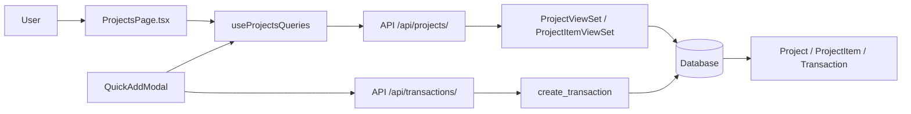

# Requirements

### Overview
Build **Phase 7 — Independent Project Finance Workspace**: separate project planning and expense tracking that syncs with the main ledger. Each project has a planning table with budgeted items, and actual transactions tagged to those items with per-item progress bars showing spent vs budgeted.

### Scope

**In Scope:**
- **Project CRUD** — Create, edit, archive projects with name, description, status.
- **Project Items (Planning Table)** — Each project has a table of items (e.g., "Cement", "Labor"). Each item has a name, estimated amount, and is editable. The system auto-calculates total estimated cost.
- **Transaction Tagging** — Existing transactions gain an optional `project_item` FK. When recording a transaction, users can assign it to a project item.
- **Per-Item Budget Tracking** — Each item shows a progress bar: actual spent (sum of tagged transactions) vs estimated budget. Over-spend highlighted in red.
- **Project Summary** — Total estimated, total spent, remaining, overall progress.
- **Transaction Sync** — Tagged transactions appear in both the main transaction list and the project view.

**Out of Scope:**
- Multi-user collaboration on projects.
- Project templates.
- File attachments to projects.
- Interest/loans within projects.

### User Stories
1. As a user, I want to create a project so I can plan and track expenses for a specific endeavor.
2. As a user, I want to add planning items with estimated costs so I know the total project budget.
3. As a user, I want to edit item names and estimates so my plan stays accurate.
4. As a user, I want to tag transactions to project items so actual spending is tracked against the plan.
5. As a user, I want to see a progress bar per item so I know if I'm over or under budget.
6. As a user, I want to see total estimated vs total spent at the project level.
7. As a user, I want tagged transactions to appear in my main transaction list too.

### Functional Requirements
- **Project Items Table**: Editable rows with name and estimated amount. Auto-sum total at bottom. Add/Delete rows.
- **Progress Bar**: Per item — green (under 80%), amber (80-100%), red (>100%). Shows spent amount and remaining.
- **Transaction Assignment**: When creating/editing a transaction, optional "Project Item" dropdown. If selected, the transaction counts toward that item's spent amount.
- **Project Summary Cards**: Total Estimated, Total Spent, Remaining, % Complete.
- **Status**: Active, On Hold, Completed, Archived. Filter by status.
- **Empty State**: "No projects yet" with CTA to create one.

### Non-Functional Requirements
- Money values as Decimal throughout — no floating-point.
- Tagging a transaction to a project item must not affect account balance — it's a metadata tag only.
- Frontend: `npm run typecheck` and `npm run lint` pass.
- Backend: `python manage.py check`, `ruff check .`, `pytest` pass.

# Technical Design

### Current Implementation
- **Projects app** (`backend/apps/projects/`): Placeholder. `models.py` is empty, `views.py` returns `[]`.
- **Transaction model**: No `project` or `project_item` field. Transactions are standalone.
- **Frontend**: `ProjectsPage.tsx` is a placeholder. No project types or hooks exist.
- **QuickAddModal**: No project item selector. Transactions are created without project context.

### Key Decisions
- **`project_item` as nullable FK on Transaction** — Adding `project_item` to the Transaction model (nullable FK to `ProjectItem`) is the simplest approach. It's a metadata tag — doesn't affect balance calculations. Existing transactions remain untagged.
- **ProjectItem owns the estimate** — `ProjectItem.estimated_amount` is the budget. Actual is computed by summing linked transactions. No cached field needed — compute on read.
- **Project total is sum of items** — `Project.total_estimated` is computed as SUM(ProjectItem.estimated_amount). Not stored — computed on read to avoid sync issues.
- **Follow existing app pattern** — Models → Serializers → ViewSets → URLs → Tests (backend), Types → Hooks → Page (frontend).

### Proposed Changes

**Backend (`apps/projects/`):**
1. **Models** (`models.py`): `Project` (user, name, description, status, start_date, end_date), `ProjectItem` (project, name, estimated_amount, notes, ordering).
2. **Transaction model change** (`apps/transactions/models.py`): Add `project_item` nullable FK to `ProjectItem` with `SET_NULL` on delete.
3. **Serializers** (`serializers.py`): `ProjectSerializer`, `ProjectItemSerializer`, `ProjectDetailSerializer` (nested items with actual_spent computed).
4. **ViewSets** (`views.py`): `ProjectViewSet` (CRUD), `ProjectItemViewSet` (CRUD within project).
5. **URLs** (`urls.py`): Wire via DefaultRouter to `/api/projects/`.
6. **Tests** (`tests.py`): Project CRUD, item CRUD, actual_spent computation, transaction tagging.

**Frontend:**
1. **Types** (`src/types/projects.ts`): `Project`, `ProjectItem`, `ProjectSummary`.
2. **Types index** (`src/types/index.ts`): Export project types.
3. **Transaction type update** (`src/types/transactions.ts`): Add `project_item?: number` and `project_item_name?: string`.
4. **Hooks** (`src/hooks/useProjectsQueries.ts`): `useProjects()`, `useProject()`, `useCreateProject()`, `useUpdateProject()`, `useProjectItems()`, `useCreateProjectItem()`, `useUpdateProjectItem()`, `useDeleteProjectItem()`.
5. **Page** (`src/pages/ProjectsPage.tsx`): Project list with summary cards, project detail view with items table (editable), per-item progress bars, total estimated vs spent.
6. **QuickAddModal update** (`src/components/transactions/QuickAddModal.tsx`): Add optional "Project Item" dropdown that fetches items from active projects.

### File Structure
```
backend/apps/projects/
  models.py          (new — Project, ProjectItem)
  serializers.py     (rewrite — 3 serializers)
  views.py           (rewrite — ViewSets)
  urls.py            (rewrite — router wiring)
  tests.py           (rewrite — pytest tests)

backend/apps/transactions/
  models.py          (modified — add project_item FK)
  serializers.py     (modified — add project_item fields)

frontend/src/
  types/projects.ts  (new)
  types/transactions.ts  (modified — add project_item)
  types/index.ts     (modified — add projects export)
  hooks/useProjectsQueries.ts  (new)
  pages/ProjectsPage.tsx       (rewrite — full page)
  components/transactions/QuickAddModal.tsx  (modified — add project item selector)
```

### Architecture Diagram


### Risks
- **Migration for Transaction model** — Adding `project_item` FK requires a migration on an existing table. The field must be nullable with a default of NULL to avoid data loss.
- **Circular import** — `Transaction` references `ProjectItem` which references `Project`. Use string FK (`'projects.ProjectItem'`) to avoid circular imports.
- **QuickAddModal complexity** — Adding a project item selector means fetching projects and items. Use a lazy fetch (only when needed) to avoid slowing down the modal.

# Testing

### Validation Approach
Follow the existing `apps/bills/tests.py` pattern: pytest with `@pytest.mark.django_db`, using fixtures from `backend/conftest.py`.

### Key Scenarios
1. **Create project** — POST returns 201, project is visible in list.
2. **Create project item** — Item belongs to project, estimated_amount is stored as Decimal.
3. **Project total estimated** — Sum of all item estimated_amounts matches.
4. **Tag transaction to item** — Transaction.project_item is set, actual_spent for that item includes the transaction amount.
5. **Actual spent computation** — Multiple transactions tagged to same item sum correctly.
6. **Over-spend detection** — When actual > estimated, API returns the variance correctly.
7. **Delete item cascades** — Deleting a project item sets transaction.project_item to NULL (SET_NULL).
8. **API integration** — GET endpoints return 200 with correct structure.

### Edge Cases
- Transaction tagged to item in archived project — allowed, but item still counts.
- Empty project (no items) — total estimated is 0, empty state shown.
- Item with no transactions — actual_spent is 0, progress bar at 0%.
- Frontend: `npm run typecheck` and `npm run lint` pass.
- QuickAddModal: Project item selector doesn't break if no projects exist.

# Delivery Steps

### ✓ Step 1: Backend models, migrations, serializers, ViewSets, URLs, and tests
Implement the projects backend: models, API layer, and transaction tagging, then validate with tests.
- `apps/projects/models.py`: Create `Project` (user, name, description, status, start_date, end_date) and `ProjectItem` (project, name, estimated_amount, notes, order).
- `apps/transactions/models.py`: Add `project_item` nullable FK (`'projects.ProjectItem'`, `SET_NULL`) to `Transaction`.
- Run `python manage.py makemigrations apps.projects apps.transactions` then `python manage.py migrate`.
- `apps/projects/serializers.py`: `ProjectSerializer`, `ProjectItemSerializer`, `ProjectDetailSerializer` (nested items with `actual_spent` computed from linked transactions).
- `apps/projects/views.py`: `ProjectViewSet` (CRUD, filtered by user), `ProjectItemViewSet` (CRUD within project, returns `actual_spent`).
- `apps/projects/urls.py`: Wire ViewSets via DefaultRouter to `/api/projects/`.
- `apps/transactions/serializers.py`: Add `project_item` and `project_item_name` (read-only) to `TransactionSerializer`.
- `apps/projects/tests.py`: 8+ tests — project CRUD, item CRUD, total estimated computation, actual_spent from tagged transactions, over-spend detection, SET_NULL on item delete, API endpoints.
- Run `python manage.py check`, `ruff check .`, and `pytest` to verify.

### ✓ Step 2: Frontend types, hooks, ProjectsPage, and QuickAddModal update
Build the frontend projects module: types, React Query hooks, full ProjectsPage, and transaction tagging in QuickAddModal.
- `src/types/projects.ts`: `Project`, `ProjectItem`, `ProjectSummary` interfaces. Money fields as `string`.
- `src/types/index.ts`: Add `export * from './projects'`.
- `src/types/transactions.ts`: Add `project_item?: number` and `project_item_name?: string` to `Transaction` and `CreateTransactionRequest`.
- `src/hooks/useProjectsQueries.ts`: `useProjects()`, `useProject()`, `useCreateProject()`, `useUpdateProject()`, `useProjectItems()`, `useCreateProjectItem()`, `useUpdateProjectItem()`, `useDeleteProjectItem()`. Follow `useBillsQueries.ts` pattern.
- `src/pages/ProjectsPage.tsx`: Project list with summary cards (Total Estimated, Total Spent, Remaining), project detail view with editable items table, per-item progress bars (green/amber/red), total row. Hooks wrapper + content component pattern. Follow `BillsPage.tsx` UI pattern.
- `src/components/transactions/QuickAddModal.tsx`: Add optional "Project Item" dropdown (visible for expense type). Fetches items from active projects. Sends `project_item` in the transaction create payload.
- Run `npm run typecheck` and `npm run lint` to verify.