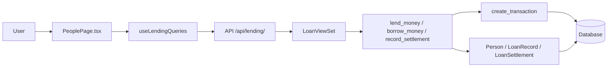

# Requirements

### Overview
Build **Phase 5 — Lending, Borrowing & Person Management**: track money lent to others, money borrowed from others, and record repayments/collections with atomic ledger integration.

### Scope

**In Scope:**
- **Person management** — CRUD for people (counterparties) with contact info and running balances.
- **Loan records** — Create lent/borrowed loans with amount, due date, status.
- **Settlements** — Record partial/full repayments, atomically creating ledger transactions and updating remaining amounts.
- **Dashboard summary** — Total lent (receivable), total borrowed (payable), net position.
- **People page** — Person directory with loan history per person.

**Out of Scope:**
- Interest calculations, reminders, notifications.
- Multi-currency loans.
- Group loans or co-borrowers.

### User Stories
1. As a user, I want to add a person so I can track who I owe money to or who owes me.
2. As a user, I want to record lending money to someone so my account balance deducts and the loan is tracked.
3. As a user, I want to record borrowing from someone so my account balance increases and the debt is tracked.
4. As a user, I want to record a repayment/collection so the loan's remaining balance updates and my account reflects the transaction.
5. As a user, I want to see a summary of total money lent vs borrowed at a glance.

# Technical Design

### Current Implementation
- **Lending app** (`backend/apps/lending/`): Placeholder only. `models.py` is empty, `views.py` returns `[]`.
- **Transaction types** already defined: `lending`, `borrowing`, `loan_repayment`, `loan_collection` in `apps/transactions/models.py`.
- **Ledger service** (`apps/transactions/services.py`): `create_transaction()` handles all types atomically. `lending`/`loan_repayment` decrement balance; `borrowing`/`loan_collection` increment balance.
- **Frontend**: `PeoplePage.tsx` is a placeholder. No lending hooks or types exist.

### Key Decisions
- **Reuse `create_transaction` service** — no new ledger logic needed. Lending creates a `lending` transaction (deducts account), borrowing creates a `borrowing` transaction (adds to account), repayments create `loan_repayment` or `loan_collection`.
- **Person model aggregates balances** — `total_lent` and `total_borrowed` cached on Person, updated atomically when loans are created/settled.
- **LoanRecord tracks remaining** — `remaining_amount` decremented on each settlement. When zero, status auto-sets to `settled`.
- **Follow existing app pattern** — Models → Serializers → ViewSets → URLs → Services → Tests (backend), Types → Hooks → Page (frontend), matching the bills/budgets structure.

### Proposed Changes

**Backend (`apps/lending/`):**
1. **Models** (`models.py`): `Person` (name, phone, email, notes, total_lent, total_borrowed), `LoanRecord` (person, loan_type, initial_amount, remaining_amount, due_date, status, notes), `LoanSettlement` (loan, transaction FK, amount, settlement_date, notes).
2. **Services** (`services.py`): `lend_money()` — creates Person if needed, creates LoanRecord, creates `lending` transaction via ledger, updates Person.total_lent. `borrow_money()` — symmetric with `borrowing` type. `record_settlement()` — creates repayment/collection transaction, updates remaining_amount and Person totals, auto-settles when remaining hits zero.
3. **Serializers** (`serializers.py`): `PersonSerializer`, `LoanRecordSerializer`, `LoanSettlementSerializer`, `LendMoneySerializer`, `BorrowMoneySerializer`, `SettleLoanSerializer`.
4. **ViewSets** (`views.py`): `PersonViewSet` (CRUD + summary action), `LoanRecordViewSet` (list/filter + lend/borrow actions), `LoanSettlementViewSet`.
5. **URLs** (`urls.py`): Wire ViewSets to `/api/lending/`.
6. **Tests** (`tests.py`): Following `apps/bills/tests.py` pattern — pytest with `@pytest.mark.django_db`, fixtures from `conftest.py`.

**Frontend:**
1. **Types** (`src/types/lending.ts`): `Person`, `LoanRecord`, `LoanSettlement`, `LendingSummary`.
2. **Types index** (`src/types/index.ts`): Export lending types.
3. **Hooks** (`src/hooks/useLendingQueries.ts`): `usePeople()`, `useLoans()`, `useLendMoney()`, `useBorrowMoney()`, `useSettleLoan()`, `useCreatePerson()`.
4. **Page** (`src/pages/PeoplePage.tsx`): Summary cards (Total Lent, Total Borrowed, Net), person directory table, "Lend/Borrow" modal with person selection or inline creation, "Record Settlement" modal.

### File Structure
```
backend/apps/lending/
  models.py          (new — Person, LoanRecord, LoanSettlement)
  services.py        (new — lend_money, borrow_money, record_settlement)
  serializers.py     (rewrite — 6 serializers)
  views.py           (rewrite — ViewSets)
  urls.py            (rewrite — router wiring)
  tests.py           (rewrite — pytest tests)

frontend/src/
  types/lending.ts   (new)
  types/index.ts     (modified — add lending export)
  hooks/useLendingQueries.ts  (new)
  pages/PeoplePage.tsx        (rewrite — full page)
```

### Architecture Diagram


### Risks
- **Migration dependency**: `LoanRecord` references `Transaction` via `LoanSettlement`. Need to ensure `create_transaction` runs first in the same atomic block before creating `LoanSettlement`.
- **Person name uniqueness**: Enforced per-user via `unique_together = ['user', 'name']` — same name for different users is fine.

# Testing

### Validation Approach
Follow the existing `apps/bills/tests.py` pattern: pytest with `@pytest.mark.django_db`, using `user`, `auth_client`, and `db` fixtures from `backend/conftest.py`.

### Key Scenarios
1. **Lend money** — creates LoanRecord (lent), deducts account balance via `lending` transaction, updates Person.total_lent.
2. **Borrow money** — creates LoanRecord (borrowed), adds to account balance via `borrowing` transaction, updates Person.total_borrowed.
3. **Partial settlement** — reduces remaining_amount, creates repayment/collection transaction, does NOT auto-settle.
4. **Full settlement** — remaining hits zero, status → `settled`.
5. **Cannot over-settle** — settlement amount > remaining raises ValueError.
6. **API integration** — POST to lend/borrow endpoints returns 201, GET summary returns correct totals.

### Edge Cases
- Settlement on already settled loan → ValueError.
- Lending to self (same account) — allowed, but tracked as lending transaction.
- Empty person list → empty state UI.
- Frontend: `pnpm typecheck` and `pnpm lint` pass.

# Delivery Steps

### ✓ Step 1: Backend models, services, and migrations
Implement lending domain models and atomic services, then generate and apply migrations.
- `models.py`: Create `Person` (user, name, phone, email, notes, total_lent, total_borrowed), `LoanRecord` (user, person, loan_type, initial_amount, remaining_amount, due_date, status, notes), `LoanSettlement` (loan, transaction FK, amount, settlement_date, notes). All DecimalFields, proper constraints.
- `services.py`: `lend_money()` — creates/gets Person, creates LoanRecord, calls `create_transaction(type='lending')`, updates Person.total_lent atomically. `borrow_money()` — symmetric with `borrowing` type. `record_settlement()` — creates `loan_repayment`/`loan_collection` transaction, decrements remaining_amount, auto-settles at zero.
- Run `python manage.py makemigrations lending` then `python manage.py migrate`.
- Run `python manage.py check` and `ruff check .` to verify.

### ✓ Step 2: Backend serializers, ViewSets, URLs, and tests
Complete the API layer with serializers, ViewSets, URL routing, and pytest validation.
- `serializers.py`: `PersonSerializer`, `LoanRecordSerializer`, `LoanSettlementSerializer`, `LendMoneySerializer` (person_name_or_id, amount, account, due_date, notes), `BorrowMoneySerializer`, `SettleLoanSerializer` (amount, account, settlement_date, notes).
- `views.py`: `PersonViewSet` (CRUD + `summary` action returning totals), `LoanRecordViewSet` (filtered by user, `lend`/`borrow` actions), `LoanSettlementViewSet`.
- `urls.py`: Wire ViewSets via DefaultRouter to `/api/lending/`.
- `tests.py`: 6+ test cases — lend creates transaction and updates balance, borrow symmetric, partial settlement, full settlement auto-sets status, over-settlement rejected, API endpoint integration.
- Run `pytest` and verify all pass.

### ✓ Step 3: Frontend types, hooks, and PeoplePage
Build the frontend lending module: types, React Query hooks, and the full PeoplePage.
- `src/types/lending.ts`: `Person`, `LoanRecord`, `LoanSettlement`, `LendingSummary` interfaces. Money fields as `string`.
- `src/types/index.ts`: Add `export * from './lending'`.
- `src/hooks/useLendingQueries.ts`: `usePeople()`, `useLendingSummary()`, `useLoans()`, `useLendMoney()`, `useBorrowMoney()`, `useSettleLoan()`, `useCreatePerson()`. Follow `useBillsQueries.ts` pattern with query invalidation.
- `src/pages/PeoplePage.tsx`: Summary cards (Total Lent, Total Borrowed, Net Position), person directory table with per-person loan balance, "Lend/Borrow" modal with person selection or inline creation and account picker, "Record Settlement" modal. Follow `BillsPage.tsx` UI pattern with 8-state matrix, WCAG AA, calculator input for amounts.
- Run `pnpm typecheck` and `pnpm lint` to verify.